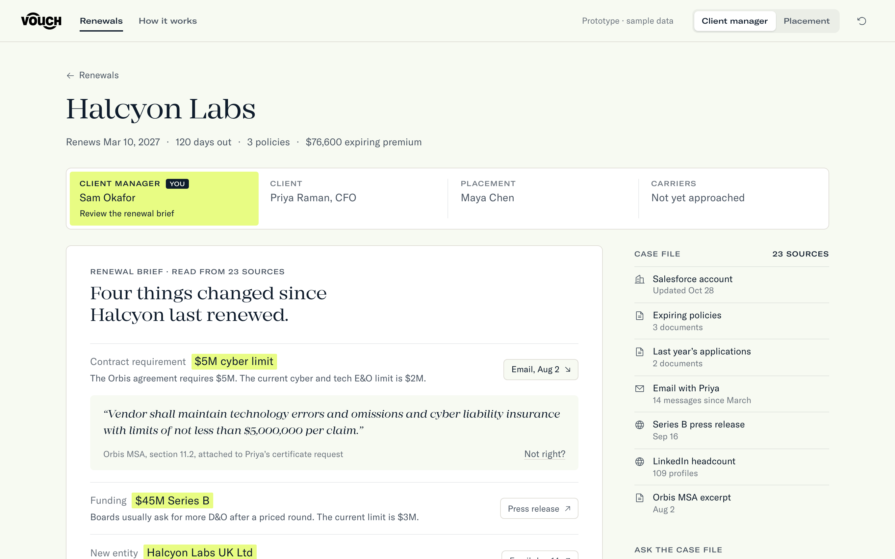
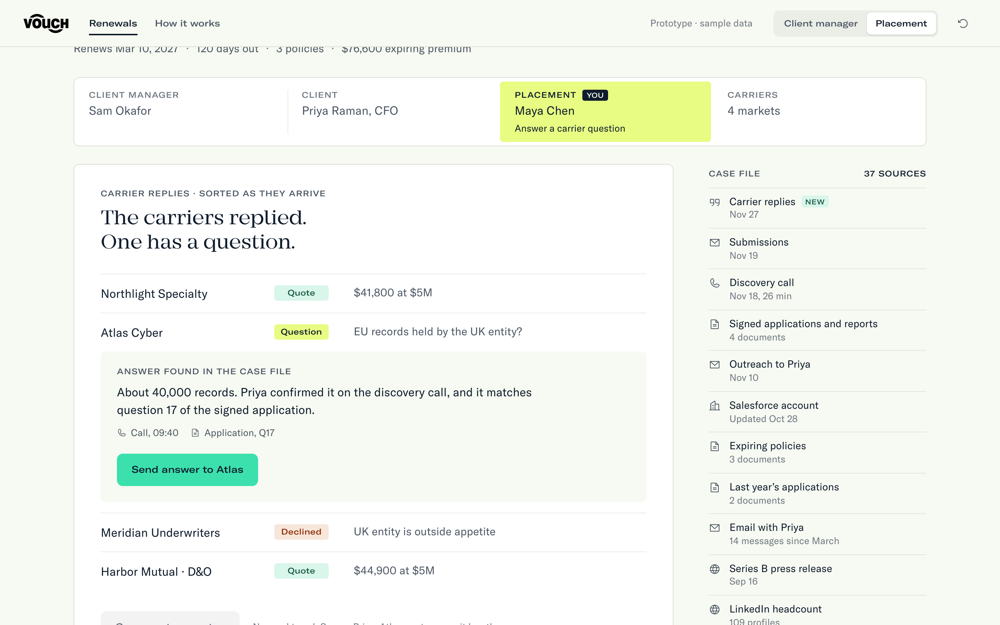
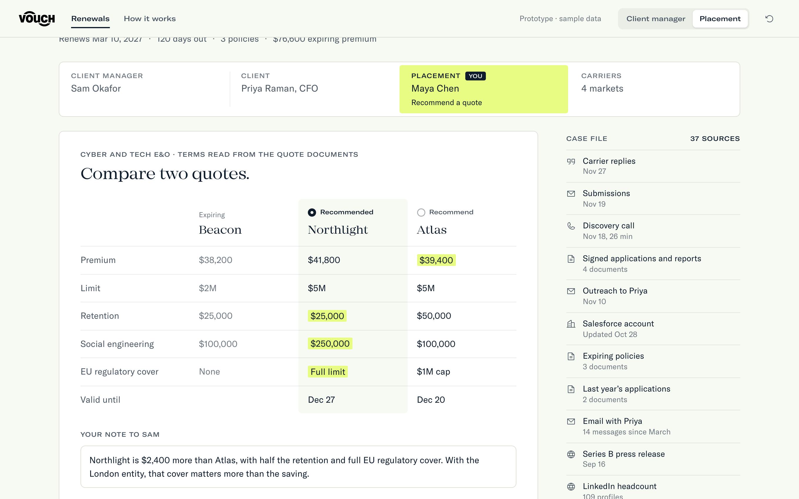
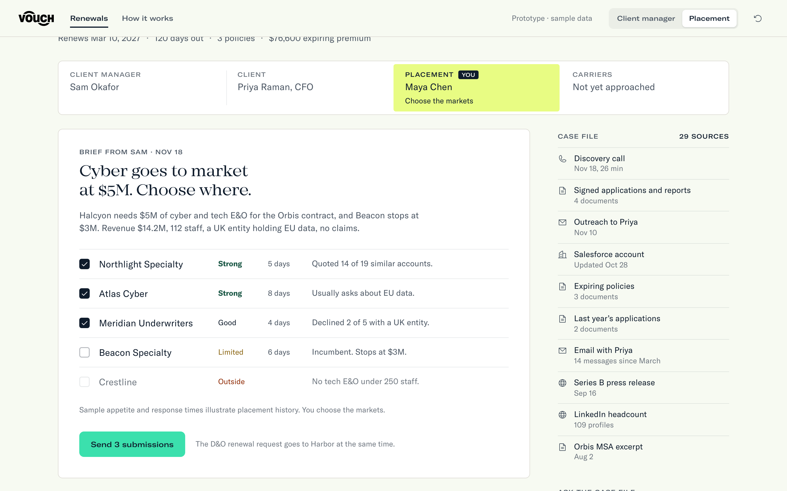
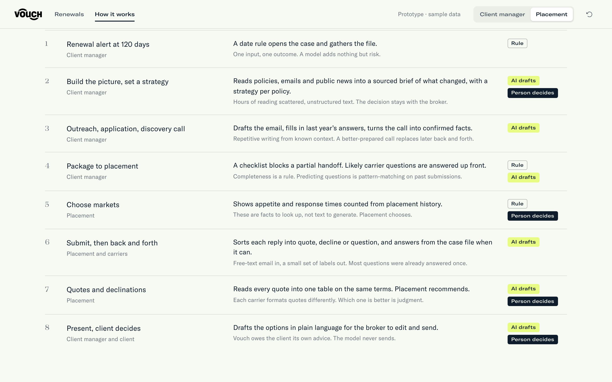

# Renewal Desk

**One renewal. One case that grows. One answer to who has the ball.**

A working prototype of how AI could carry an insurance renewal from the 120-day alert to the client's decision, with a broker deciding at every point that counts.

**[Open the live demo](https://sebastianrtj.github.io/vouch-renewal-desk/#/halcyon-labs)** · [How it works](https://sebastianrtj.github.io/vouch-renewal-desk/#/how-it-works) · [Presenter mode](https://sebastianrtj.github.io/vouch-renewal-desk/?present=1&scene=brief#/halcyon-labs)


## The problem

A renewal today is eight steps across two teams, a client and several carriers, mostly in email. The client manager assembles the picture in their head. Placement gets a partial package and sends questions back. Carriers ask for things the client already said once. Nobody can see at a glance whose move it is.

Renewal Desk is built on two ideas:

1. **One case file.** Every email, document, call and carrier reply lands in one record, so nothing has to be asked twice.
2. **The ball.** At any moment exactly one party has to act: the client manager, the client, placement, or the carriers. The marker moves; the work in front of you is always the one next thing.

## What it does

### Reads the file so the broker does not have to

Before the first call, the brief shows what changed since the last renewal, why each change matters for cover, and the exact source behind it. The broker can open the evidence, dismiss a point that is wrong, and set the strategy per policy. Nothing is sent until they approve.



### Answers the carrier from what is already known

A carrier asks how many EU records the UK entity holds. The answer was given on the discovery call and again in the application. Placement sends it in one click. No email to the client manager, no email to the client.



### Puts every quote on the same terms

Carriers format quotes differently. The comparison reads them into one table and marks where they differ. Placement picks, writes one line of reasoning, and hands the ball back.



### Keeps facts as facts

Carrier appetite and response times are counted from placement history, not generated. The model summarizes; it does not invent a number.



## Where AI belongs, and where it does not

Rules where the answer must be the same every time. A model where the input is messy text. A person wherever the firm is giving advice.



| Step today | In Renewal Desk | Kind |
|---|---|---|
| Renewal alert at 120 days | A date rule opens the case | Rule |
| Build the picture, set a strategy | Sourced brief of what changed, a strategy per policy | AI drafts, person decides |
| Outreach, application, discovery call | Drafted email, prefilled answers, call turned into confirmed facts | AI drafts |
| Package to placement | A checklist blocks a partial handoff | Rule, AI drafts |
| Choose markets | Appetite and timing from placement history | Rule, person decides |
| Submit, then back and forth | Replies sorted into quote, decline or question; answered from the file when possible | AI drafts |
| Quotes and declinations | One table on the same terms | AI drafts, person decides |
| Present, client decides | Options drafted in plain language for the broker to edit | AI drafts, person decides |

**What to build first:** the case file, then the change brief. The first is what everything else stands on. The second saves the most reading for the least risk.

## Try it

Play the Halcyon Labs case as the client manager, and switch to placement (top right) when the ball moves there. Worth trying:

- Open a source on the brief, then mark it "Not right?"
- Flip a policy from Renew to Remarket
- Edit the outreach before sending
- Uncheck a market and watch the replies, the comparison and the client email follow
- Ask the case file a question in the side panel

## What is real

This is a front-end prototype. **Every client, carrier, quote, email and document is invented.** No model is called, nothing is sent, and no system is integrated; the briefs, drafts and answers are fixtures that show the intended behavior. Client and carrier replies are the buttons marked "Demo · skip ahead". The measures named on the How it works page are proposals, not results.

Built as an interview exercise for Vouch. It is not a Vouch product and is not affiliated with or endorsed by Vouch. The wordmark and typefaces belong to Vouch; the typefaces load from vouch.us and are not stored in this repository.

## Run it

```sh
npm install
npm run dev
```

Open http://localhost:5183.

## How it is built

React, TypeScript and Vite, with no backend.

| File | What it holds |
|---|---|
| [`src/model.ts`](src/model.ts) | The case as a reducer: eleven steps, who has the ball at each, and every action |
| [`src/Case.tsx`](src/Case.tsx) | Renders any state of the case |
| [`src/Tour.tsx`](src/Tour.tsx) | The scripted walkthrough. It renders the same `Case` component, so it always shows the real screens |
| [`src/How.tsx`](src/How.tsx) | The workflow page |
| [`src/data.ts`](src/data.ts) | The sample case |

The walkthrough uses [Stageshow](https://github.com/benjitaylor/skills/tree/main/stageshow) (MIT), copied to `src/kit/` with its license and notices. It passes Stageshow's film gate; see [REHEARSAL.md](REHEARSAL.md).
